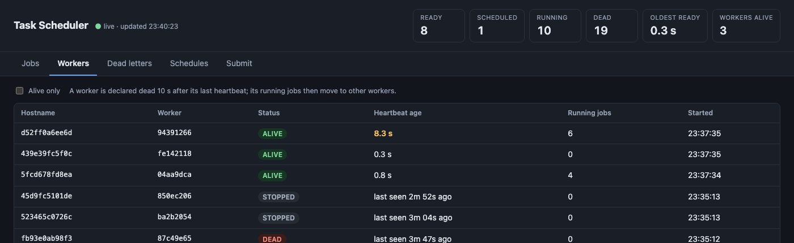
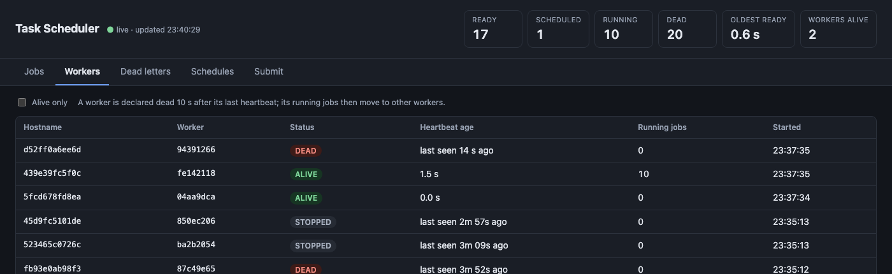
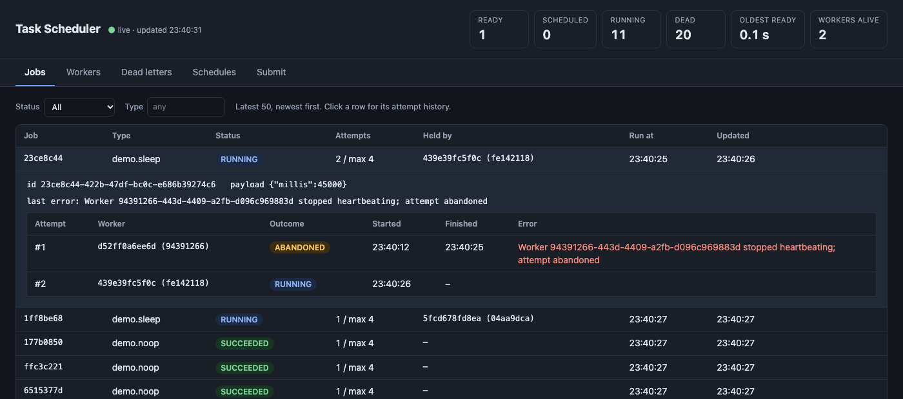
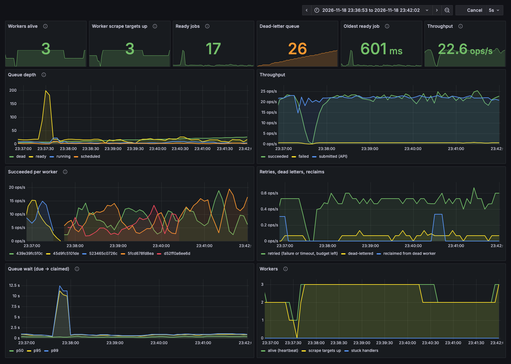

# Task Scheduler

A distributed job scheduler (a small Celery / Quartz) where **PostgreSQL is the only
infrastructure**: it is the queue, the lock manager and the source of truth. Clients submit
jobs over REST; any number of identical workers claim and run them.

- **Atomic claiming** with `SELECT ... FOR UPDATE SKIP LOCKED`: N workers never run the same
  claim twice and never block each other.
- **Retries** with exponential backoff and full jitter, then a **dead-letter queue**.
- **Crash recovery**: workers heartbeat; jobs held by a dead worker are reclaimed and rerun.
- **Graceful shutdown**: a stopping worker drains, then hands unfinished jobs back without
  spending their retry budget.
- **Cron schedules** that fire exactly one job per tick, however many instances are running.
- **Per-job timeouts**, priorities, delayed jobs, idempotency keys.
- **Observability**: Prometheus metrics, a provisioned Grafana dashboard, and a small admin UI
  for watching jobs and workers live.

The delivery guarantee is **at-least-once**: a job can run more than once (a worker may crash
after doing the work but before recording it), so handlers must be idempotent.

[`DESIGN.md`](DESIGN.md) explains the schema, the state machine, every SQL statement on the
hot path, and why each decision was made.

## Quickstart

Requires Docker.

```bash
docker compose up --build        # postgres + 1 api + 3 workers + prometheus + grafana
```

| | URL |
|---|---|
| Admin UI | <http://localhost:8080> |
| Grafana dashboard | <http://localhost:3000> (no login) |
| Prometheus | <http://localhost:9090> |
| REST API | `http://localhost:8080/api/v1/...` |

Grafana allows anonymous read-only access so the demo needs no login. That is fine for a stack
running on your own machine and is not a configuration to expose on a network. The same goes
for the admin UI and API, which have no authentication at all.

Submit a job:

```bash
curl -s -X POST localhost:8080/api/v1/jobs -H 'Content-Type: application/json' -d '{
  "type": "demo.sleep",
  "payload": {"millis": 500},
  "priority": 5,
  "maxRetries": 3,
  "idempotencyKey": "readme-1"
}'
```

```json
{"id":"38423c2b-0681-469a-90c2-5a9125a3da9e","type":"demo.sleep","payload":{"millis":500},
 "priority":5,"status":"PENDING","runAt":"2026-11-17T03:07:38.593705Z","attempts":0,
 "attemptsExcused":0,"maxRetries":3,"timeoutSeconds":300,"idempotencyKey":"readme-1", ...}
```

Only `type` is required. Sending the same `idempotencyKey` again returns the existing job
(200 instead of 201); sending it with a different body returns 409.

```bash
curl -s localhost:8080/api/v1/jobs/<id>            # status + one history entry per attempt
curl -s 'localhost:8080/api/v1/jobs?status=SUCCEEDED'
curl -s localhost:8080/api/v1/workers
```

Three demo job types are built in:

| Type | Behaviour |
|---|---|
| `demo.noop` | Succeeds immediately |
| `demo.sleep` | Sleeps for payload `millis` (default 1000) |
| `demo.flaky` | Fails until the attempt number reaches payload `succeedOnAttempt`; without it, fails every time and ends in the DLQ |

## Demo: watch a worker die

Open the admin UI at <http://localhost:8080> and Grafana at <http://localhost:3000> side by
side.

1. In the UI's **Submit** tab, submit 3 `demo.sleep` jobs with payload `{"millis": 45000}`.
   You land on the **Jobs** tab. Click one of the running jobs: **Held by** shows the
   container holding it, for example `d52ff0a6ee6d`.
2. Kill that container. `SIGKILL` gives it no chance to clean up or release anything:

   ```bash
   docker kill d52ff0a6ee6d
   ```

3. On the **Workers** tab the killed worker still says `ALIVE`. It is only *believed*
   alive until its heartbeat is too old. Its heartbeat age climbs and turns amber; the other
   workers keep refreshing every 2 s:

   

4. About 10 s after the kill (the heartbeat timeout in `compose.yaml`), a reaper on one of
   the surviving workers declares it `DEAD` and puts its running jobs back in the queue:

   

5. Back on **Jobs**, the job you opened (also reachable at `/#jobs/<id>`) shows its attempt
   history: attempt 1 `ABANDONED` on the dead container, attempt 2 already `RUNNING` on
   another worker. The abandoned attempt counts against the retry budget (`2 / max 4`), so a
   job that crashes every worker it touches ends in the DLQ instead of looping forever:

   

6. In Grafana, the killed container's line in **Succeeded per worker** stops. In **Workers**,
   "scrape targets up" drops within seconds (Prometheus loses the container), but
   "alive (heartbeat)" drops only about 10 s later: the gap is the detection delay that crash
   recovery pays. A blip in **reclaimed from dead worker** follows.

   

   This screenshot was taken while a script submitted about 20 jobs/s. The spike in ready
   jobs and queue wait near 23:37:30 is all workers being recreated at once by a rebuild;
   the kill is at 23:40:13.

Use `docker compose up -d` afterwards to bring the killed worker back.

## Demo: kill a worker mid-job, from the command line

Start a 20-second job and find the container running it (a worker's hostname is its
container id):

```bash
curl -s -X POST localhost:8080/api/v1/jobs -H 'Content-Type: application/json' \
  -d '{"type": "demo.sleep", "payload": {"millis": 20000}, "idempotencyKey": "crash-demo"}'

curl -s 'localhost:8080/api/v1/workers?status=ALIVE'    # the one with "runningJobs": 1
docker kill <hostname>                                  # SIGKILL: no chance to clean up
```

Within about 13 seconds (10 s heartbeat timeout + 3 s reaper interval in `compose.yaml`)
another worker declares it dead, takes the job back and reruns it. The job's history shows
both attempts:

```bash
curl -s 'localhost:8080/api/v1/jobs?type=demo.sleep'    # find the id
curl -s localhost:8080/api/v1/jobs/<id>                 # attemptHistory: ABANDONED, then SUCCEEDED
```

Use `docker stop <hostname>` instead to see graceful shutdown: the worker waits up to 30 s
for the job, then releases it. The first attempt is recorded as `RELEASED`, `attemptsExcused`
becomes 1, and the worker ends as `STOPPED` rather than `DEAD`.

`scripts/smoke-test.sh` runs all of this unattended and checks the results: 200 jobs across
3 workers with exactly one attempt each, a flaky job that succeeds on its third attempt,
`docker kill` recovery, `docker stop` release, the metrics endpoint, the admin UI, and
Prometheus and Grafana (4 targets up, dashboard provisioned and returning data).

## More of the API

```bash
# Retries and the dead-letter queue
curl -s -X POST localhost:8080/api/v1/jobs -H 'Content-Type: application/json' \
  -d '{"type": "demo.flaky", "maxRetries": 2}'          # fails 3 times, then DEAD
curl -s localhost:8080/api/v1/dlq
curl -s -X POST localhost:8080/api/v1/dlq/<id>/requeue  # fresh retry budget

# Delayed job; cancel it while it is still pending
curl -s -X POST localhost:8080/api/v1/jobs -H 'Content-Type: application/json' \
  -d '{"type": "demo.noop", "runAt": "2030-01-01T00:00:00Z"}'
curl -s -X POST localhost:8080/api/v1/jobs/<id>/cancel

# A cron schedule: six fields, seconds first, evaluated in the given timezone
curl -s -X POST localhost:8080/api/v1/schedules -H 'Content-Type: application/json' \
  -d '{"name": "every-10s", "cron": "*/10 * * * * *", "jobType": "demo.noop", "timezone": "UTC"}'
curl -s -X POST localhost:8080/api/v1/schedules/<id>/pause
curl -s -X POST localhost:8080/api/v1/schedules/<id>/resume
curl -s -X DELETE localhost:8080/api/v1/schedules/<id>
```

Errors are RFC 9457 problem documents:

```json
{"title":"Bad Request","status":400,"detail":"Invalid request content.",
 "instance":"/api/v1/jobs","errors":{"type":"may contain only letters, digits, '.', '_' and '-'"}}
```

The full endpoint list is in [DESIGN.md §9](DESIGN.md#9-api-and-metrics).

## Metrics

Every process serves Prometheus metrics at `/actuator/prometheus`.

```bash
curl -s localhost:8080/actuator/prometheus | grep -E '^(jobs|workers)_'
```

| Metric | Meaning |
|---|---|
| `jobs_queue_depth{state}` | Jobs that are `ready`, `scheduled` (future run-at or backing off), `running`, `dead` |
| `jobs_oldest_pending_age_seconds` | How long the oldest ready job has waited. The "are we keeping up" signal |
| `workers_alive` | Workers with a current heartbeat |
| `job_queue_wait_seconds{type}` | Time from a job becoming due to being claimed |
| `job_execution_duration_seconds{type,outcome}` | Time spent in the handler |
| `claim_query_duration_seconds` | Time per claim query |
| `jobs_{submitted,claimed,succeeded,failed,retried,dead,timed_out,released}_total{type}` | Lifecycle counters |
| `jobs_reclaimed_total{result}` | Jobs taken back from dead workers |
| `schedules_fired_total` | Jobs created by cron schedules |
| `jobs_handlers_stuck` | Timed-out handlers that ignored interruption and still hold a slot |

Every series has a `host` tag: the container id, which is also the hostname the admin UI
shows for a worker.

Counters and timers are per process: the API reports submissions, each worker reports its own
claims and executions. Prometheus scrapes the API and every worker (found through Compose's
DNS, so `--scale worker=5` needs no config change) and the Grafana dashboard sums them. The
queue gauges come from the database, so every instance reports the same values; the
dashboard takes `max()` of them rather than summing. The latency timers publish histogram
buckets, so percentiles in Grafana are computed across all workers.

The dashboard (`observability/grafana/dashboards/task-scheduler.json`) shows: workers alive
vs. scrape targets up, queue depth by state, oldest ready job, throughput, succeeded per
worker, retries / dead letters / reclaims / releases, and queue wait p50 / p95 / p99.

## Admin UI

Served by the API at `/`; three static files with no framework, build step or external
requests (`src/main/resources/admin-ui/`). It polls the REST API every 2 seconds while the
tab is visible.

- **Jobs**: latest 50 with status and type filters; click a row (or open `/#jobs/<id>`) for
  the payload, last error and every attempt with its worker and outcome; cancel pending jobs.
- **Workers**: status, heartbeat age (amber past a third of the timeout, red past it),
  running jobs.
- **Dead letters**: last error per job, with requeue.
- **Schedules**: pause, resume, delete, and a form to create one.
- **Submit**: any job type with a payload, up to 500 at once.

The header tiles come from `GET /api/v1/stats` (counts of active job states, oldest ready
age, workers alive). Worker responses include `heartbeatAgeSeconds`, and job responses
include `lockedBy`, the worker holding a running job.

## Throughput

About **11,500 no-op jobs/s with 3 workers** (30 concurrent slots) on one laptop:

| Run | Jobs | Elapsed | Throughput |
|---|---|---|---|
| 1 (cold JVMs) | 20,000 | 2.92 s | 6,852 jobs/s |
| 2 | 50,000 | 4.31 s | 11,595 jobs/s |
| 3 | 50,000 | 4.33 s | 11,543 jobs/s |

Measured with `scripts/benchmark.sh` on an 8-core Apple M3 with 16 GB, everything (Postgres,
API, workers) in Docker Desktop on that one machine. The script inserts the jobs with one SQL
statement and times first claim to last ack on the database clock, so this is the scheduler's
own overhead per job (one claim statement per batch, one ack statement per job) with an empty
handler. It is not a measurement of submission over HTTP, and real handlers will dominate it.

```bash
docker compose up -d --build
scripts/benchmark.sh 50000
```

## Writing a handler

Implement `JobHandler` and expose it as a Spring bean; the worker finds it by `type()`.

```java
@Component
class SendWelcomeEmail implements JobHandler {

    @Override
    public String type() {
        return "email.welcome";
    }

    @Override
    public void handle(JobContext context) throws Exception {
        String to = context.payload().path("to").asText();
        // Must be idempotent: this can run more than once for the same job.
        // Throw to retry with backoff; throw NonRetryableException to go straight to the DLQ.
    }
}
```

A handler that exceeds the job's `timeoutSeconds` is interrupted and the attempt is recorded
as `TIMED_OUT`, so blocking calls should respond to interruption.

## Configuration

Set in `application.yml` or as environment variables (`SCHEDULER_WORKER_CONCURRENCY=20`).

| Property | Default | Meaning |
|---|---|---|
| `scheduler.api.enabled` | `true` | Serve the REST API |
| `scheduler.worker.enabled` | `true` | Run the worker, reaper and cron firer |
| `scheduler.worker.concurrency` | `10` | Jobs executing at once per worker |
| `scheduler.worker.poll-interval` | `1s` | Pause between claims when the queue is not full |
| `scheduler.worker.shutdown-grace` | `30s` | How long shutdown waits for running jobs before releasing them |
| `scheduler.worker.heartbeat-interval` | `5s` | How often a worker heartbeats |
| `scheduler.worker.heartbeat-timeout` | `30s` | Heartbeat age at which a worker is declared dead |
| `scheduler.worker.reaper-interval` | `10s` | How often dead workers are looked for |
| `scheduler.worker.retry.base-delay` / `max-delay` | `5s` / `1h` | Backoff: `min(max, base * 2^(n-1))`, full jitter |
| `scheduler.schedule.poll-interval` | `1s` | How often due cron schedules are fired |
| `scheduler.metrics.refresh-interval` | `5s` | How long queue gauges are cached |
| `scheduler.demo-handlers.enabled` | `true` | Register the `demo.*` handlers |

If you raise `shutdown-grace`, raise `spring.lifecycle.timeout-per-shutdown-phase` (45 s) and
the container's stop timeout (`stop_grace_period`, 40 s in `compose.yaml`) to stay above it.

## Development

Requires JDK 21 and a running Docker daemon (tests use Testcontainers with a real Postgres).

```bash
./mvnw verify                          # all tests
./mvnw test -Dtest=CrashRecoveryTest
scripts/smoke-test.sh                  # end-to-end against the Compose stack

docker compose up postgres             # database only, then run the app from an IDE
                                       # (admin UI then at http://localhost:8080)
docker compose up --build --scale worker=5
```

The concurrency claims are tested with real concurrent workers against a real database, for
example: 8 workers and 1,000 jobs with each job executed exactly once; 4 cron firers producing
one job per tick; concurrent reapers reclaiming a dead worker's job once; a stalled worker's
late result being rejected by fencing.

Stack: Java 21, Spring Boot 4, PostgreSQL 16, Flyway, `JdbcClient` with hand-written SQL,
Micrometer, JUnit 5, Testcontainers, Awaitility.

## Limitations

- At-least-once only; handlers must be idempotent.
- Priority is strict, so a steady stream of high-priority jobs can starve lower ones.
- Timeouts are cooperative: a handler that ignores interruption cannot be killed.
- Finished jobs are never deleted.
- No authentication.

Details and intended fixes are in [DESIGN.md §12-13](DESIGN.md#12-known-limitations).
